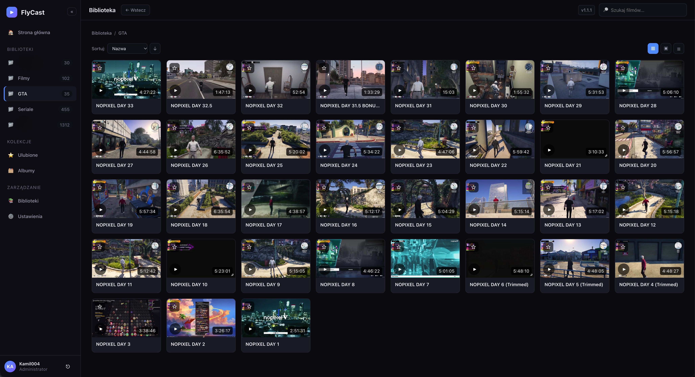

# FlyCast

Lekka aplikacja wideo typu Plex/Emby bez zbędnych wodotrysków.



## Cechy
- Direct Play + opcjonalne transkodowanie (FFmpeg)
- Zmiana jakości z podglądem bitrate'u (dropdown z opcjami: Oryginał, 25%, 50%, 75%, 100%)
- Zmiana prędkości odtwarzania (0.5x–2.0x)
- Przewijanie ±10s (pracuje dla transkodowanych strumieni)
- Pasek postępu z poprawnym czasem całkowitym (dla transkodowanych strumieni)
- Profile użytkowników
- Albumy / foldery z miniaturkami generowanymi przy skanowaniu
- Podstawowy agent metadata (TMDB – modułowy pod dalsze serwisy)
- SQLite, jeden binarny Go + SPA Vue 3
- Port HTTP 8100

## Szybki start (lokalny)
```bash
# backend
cd backend
go mod tidy
go run ./cmd/flycast

# frontend (dev)
cd frontend
npm i
npm run dev
```

## Build QPKG
```bash
bash build.sh
```

## Zmienne środowiskowe
- `FLYCAST_PORT=8100`
- `FLYCAST_HOME=/share/CACHEDEV1_DATA/.qpkg/FlyCast/shared`
- `FLYCAST_WEBROOT=/share/CACHEDEV1_DATA/.qpkg/FlyCast/app/web`
- `FLYCAST_LIBRARY=/path/to/movies,/path/to/series`
- `FFMPEG_PATH=ffmpeg`
- `FFPROBE_PATH=ffprobe`
- `FLYCAST_JWT_SECRET` — domyślnie generowany losowo przy starcie (drukowany w stderr)

## Build
```bash
bash build.sh          # frontend + Go + FFmpeg + QPKG
```

Generuje `FlyCast_<version>.qpkg` gotowe do instalacji na QNAPie.

## Struktura projektu
```
FlyCast/
├── backend/            # Go (Fiber) backend
│   ├── cmd/flycast/    # entrypoint
│   └── internal/       # api, auth, config, db, scanner
├── frontend/           # Vue 3 + Vite + Video.js
│   └── src/
├── build/              # skrypty build i QPKG
├── QPKG/               # konfiguracja pakietu QNAP
└── scripts/
```
